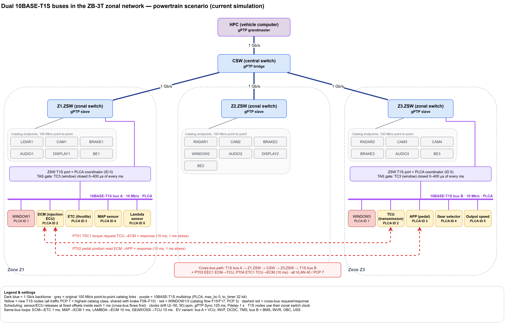
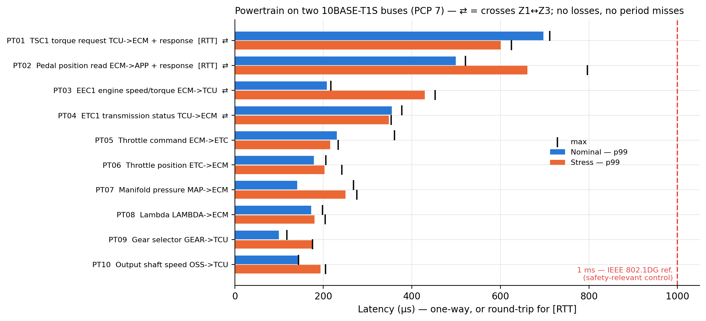
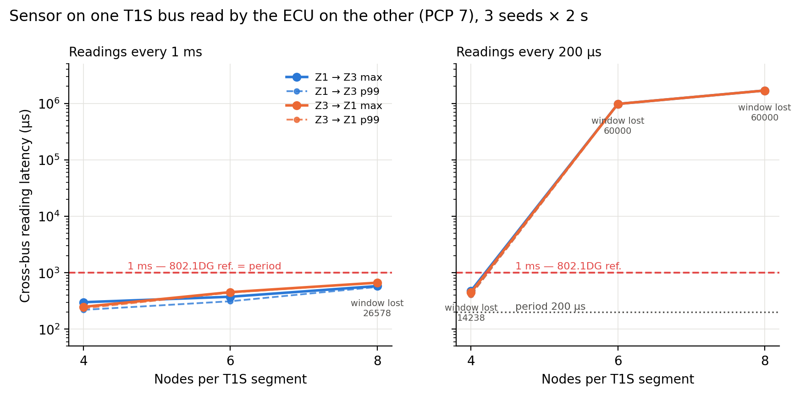
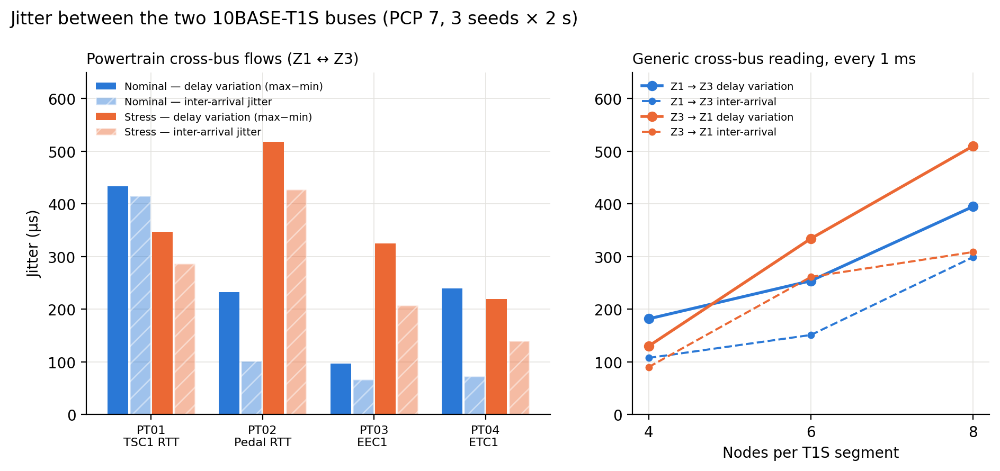
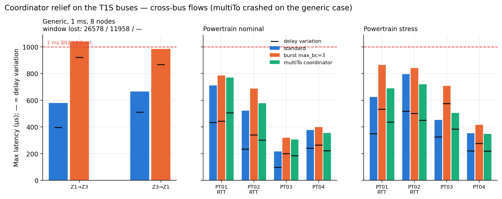
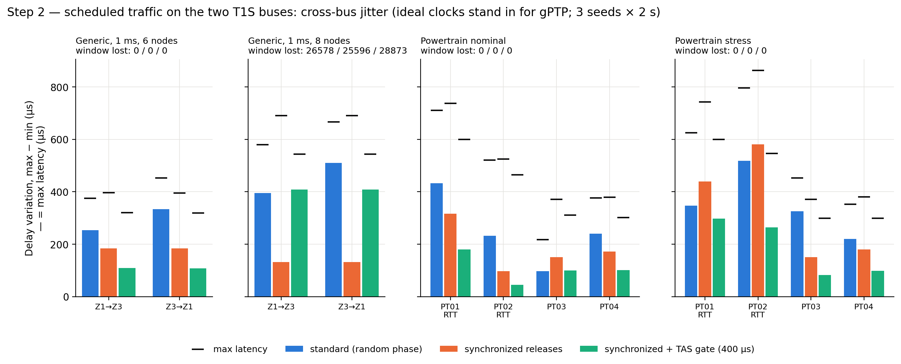
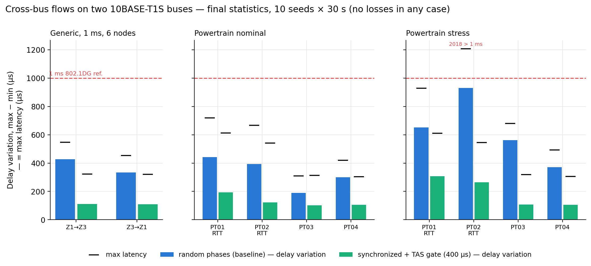
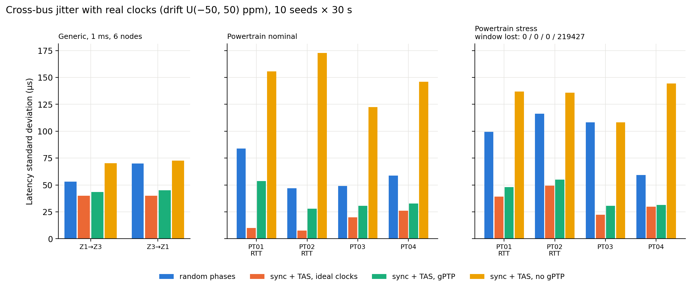
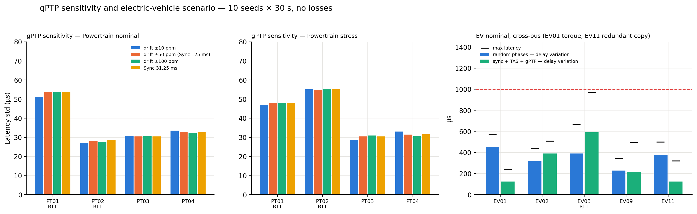
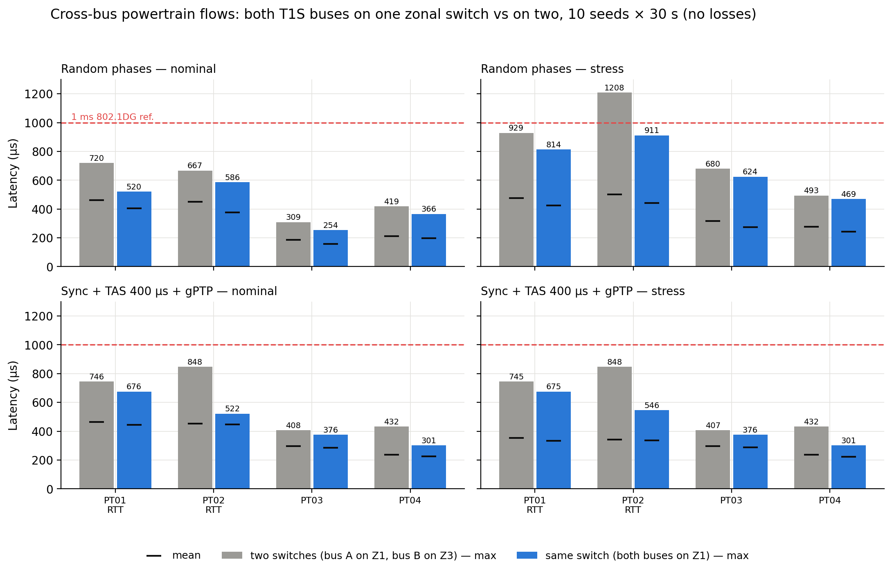

# Results: two 10BASE-T1S buses in the zonal network

Jean Carlos Macedo · branch `t1s-dualbus` · last update 2026-11-12

Two 10BASE-T1S buses carrying PCP 7 traffic meet the 1 ms IEEE 802.1DG reference for powertrain traffic. The jitter between the buses, however, is only controlled with time-based scheduling: synchronized readings and a TAS gate on the coordinator.

## Scenario and methodology

**Network.** The base is the ZB-3T zonal architecture of the P1 catalog (OMNeT++ 6.4, INET), with HPC, central switch (CSW) and three zonal switches. In zones Z1 and Z3 the window link is replaced, on the same zonal switch port, by a 10BASE-T1S segment with PLCA. The switch port is the coordinator (ID 0) and the window is ID 1. Radar, brake and the other catalog flows stay on their original links. How PLCA was integrated (interfaces, multidrop link, node IDs, queues, forwarding) is described in [`simulations/zonal/README_t1s.md`](../simulations/zonal/README_t1s.md) and in the generator [`scripts/run/gen_t1s_powertrain.py`](../scripts/run/gen_t1s_powertrain.py).

**Priority.** All new traffic uses PCP 7/TC7, the highest class of the catalog, which is also the brake class (F08–F10). The window (F15/F17) stays at PCP 3.

**Scenarios.**

- *Generic:* each bus has one ECU and 1 to 5 sensors. Each ECU reads the sensors of the other bus every 1 ms (or 200 µs as stress), with 64 B frames.
- *Powertrain:* bus A (Z1) holds the ECM, electronic throttle (ETC), MAP sensor and lambda sensor. Bus B (Z3) holds the TCU, accelerator pedal (APP), gear selector and output shaft speed sensor (OSS). Across the buses there are TSC1 TCU⇄ECM and the pedal read ECM⇄APP (request/response, 10 ms, or 1 ms under stress), plus EEC1 and ETC1 (10 ms). Periods follow the SAE J1939 engine and transmission messages. Injectors and ignition stay hardwired to the ECM.

**Metrics.**

- One-way latency (source → destination application) or round-trip time (request → response, zero server processing time).
- Delay variation (max − min), standard deviation and inter-arrival jitter (max |Δt − period|).
- Losses, including the window's.

**Deadline reference.** The 100 µs value of P1 refers to internal switch forwarding, not to information validity, so it is not used here. The reference adopted is the one from the IEEE 802.1DG working-group contributions for safety-relevant control: latency below 1 ms (Chen & Zhang, 2019; Gopal & Lawlis, 2021).

**Runs.** Exploratory: 3 seeds × 2 s with 1 s warm-up. Final: 10 seeds × 30 s, as in F6.

## Latency and capacity without scheduling

Without scheduling, with random phases, the powertrain meets 1 ms on every flow with no losses. The limit appears at the coordinator when the load grows (figures 6 and 7; 3 seeds × 2 s).

- **Powertrain:** the round trip across the buses reaches at most 0.71 ms (TSC1) nominal and 0.80 ms (pedal) under stress. One-way across buses is 0.22–0.45 ms, and on the same bus 0.12–0.36 ms. No flow exceeds its own period. Brake and radar are unchanged (~31 µs).
- **Generic, reading every 1 ms:** the maximum goes from ~0.30 ms (4 nodes per segment) to ~0.67 ms (8 nodes). With 8 nodes, however, the window loses ~26.6 k packets.
- **Generic, reading every 200 µs:** from 6 nodes on the segment saturates. Latency reaches seconds and the window loses every packet.
- **Cause:** the coordinator has a single transmit opportunity (TO) per PLCA cycle, and all traffic coming from the other bus leaves through it. PCP 7 goes ahead of the window (PCP 3), whose queue fills up.

## Jitter between the buses

With random phases, the delay variation between the buses is 100–520 µs and grows with the number of nodes (figure 8).

- **Powertrain (Z1↔Z3):** max − min variation of 100–430 µs nominal and 220–520 µs under stress. Standard deviation 20–130 µs, inter-arrival jitter 65–430 µs.
- **Generic at 1 ms:** 130–180 µs with 4 nodes, 250–330 µs with 6 and 400–510 µs with 8.
- **Mechanism:** the reading waits for its own TO on the source segment and then for the coordinator TO on the destination segment. Both waits depend on the PLCA cycle position when the reading arrives, and that position is random with respect to the release.

## Giving the coordinator more turns does not reduce jitter

Neither PLCA burst nor PrioPLCA multiTo on the coordinator reduces the jitter between the buses (figure 9).

- **Burst (`max_bc = 3` on the coordinator):** with 8 nodes and reading every 1 ms, window losses halve (26.6 k → 12 k). Cross-bus latency, however, rises from 0.67 to 1.04 ms and delay variation from ~0.5 to ~0.9 ms, because the coordinator holds the medium longer. In the powertrain the maxima rise by 70 to 250 µs.
- **multiTo (coordinator in every other slot):** mixed effect in the powertrain, no clear jitter gain. In the generic scenario the PrioPlca module aborts with "Unhandled event in state DS_PENDING". This also happened in 1 of the 3 stress seeds, which was therefore computed with 2 seeds. It is a PrioPlca defect under high load still to investigate.
- **Conclusion:** the problem is not how often the coordinator transmits but the random phase between reading releases and the PLCA cycle.

## Scheduling: synchronized readings and TAS gate

With synchronized readings and the window class closed for the first 400 µs of each millisecond, the jitter between buses drops 2 to 5 times and every flow stays ≤ 0.61 ms, with no losses (figures 10 and 11; final numbers with 10 seeds × 30 s).

**How it works.** Each source is released at a fixed instant within the millisecond: first the cross-bus flows, then the local loops, spaced by one TO plus one frame (~70 µs). On both coordinators a TAS gate closes TC3 (window) in [0, 400) µs of each ms. Clocks are ideal, standing in for gPTP; the next section uses real clocks. With the gate closed 700–800 µs the jitter dropped further, but the window lost 12 to 29 k packets. With 400 µs there are no losses.

**Final numbers (10 seeds × 30 s), cross-bus flows.** Each cell is max − min variation / standard deviation / inter-arrival jitter, in µs.

| Flow | Random phases | Synchronized + TAS 400 µs | Max (random → scheduled) |
|---|---|---|---|
| Generic Z1→Z3 (6 nodes) | 428 / 53 / 252 | 110 / 40 / 94 | 546 → 322 µs |
| Generic Z3→Z1 (6 nodes) | 334 / 70 / 283 | 109 / 40 / 94 | 453 → 320 µs |
| Nominal PT01 TSC1 (round trip) | 442 / 84 / 416 | 192 / 10 / 182 | 720 → 613 µs |
| Nominal PT02 pedal (round trip) | 394 / 47 / 236 | 122 / 7.6 / 105 | 667 → 541 µs |
| Nominal PT03 EEC1 | 190 / 49 / 144 | 102 / 20 / 99 | 309 → 314 µs |
| Nominal PT04 ETC1 | 300 / 59 / 108 | 105 / 26 / 100 | 419 → 304 µs |
| Stress PT01 (round trip) | 652 / 100 / 546 | 308 / 39 / 298 | 929 → 610 µs |
| Stress PT02 (round trip) | 931 / 116 / 546 | 265 / 49 / 246 | 1208 → 546 µs |
| Stress PT03 | 562 / 108 / 223 | 108 / 22 / 95 | 680 → 319 µs |
| Stress PT04 | 372 / 59 / 240 | 106 / 30 / 97 | 493 → 305 µs |

- With random phases, the 30 s runs show a worst case the 2 s runs missed: the pedal read under stress exceeds 1 ms in 2,018 of 300 k samples. With scheduling no sample does.
- The remaining jitter, ~100 µs on one-way flows, is about one PLCA TO summed over the two segments.
- With 8 nodes and reading every 1 ms, scheduling does not help: the window loses ~26 k packets with or without the TAS gate. The load exceeds the capacity of a single coordinator.

Data: `simulations/zonal/t1s_results/dualbus_final_30s.csv`, `relief.csv`.

## Real clocks: gPTP versus free-running clocks

With real clocks synchronized by gPTP, scheduling keeps every cross-bus flow ≤ 0.85 ms and the standard deviation below the random-phase case. Without gPTP, scheduling is worse than not scheduling (figure 12; 10 seeds × 30 s).

**Model.** Each clock drifts by U(−50, +50) ppm, drawn per node and seed, as in the official C4. gPTP follows the C4 hierarchy: HPC as grandmaster, CSW as bridge and the zonal switches as slaves, Sync every 125 ms and Pdelay every 1 s. The TAS gate and the sources of each T1S bus use their own zonal switch clock. To avoid packet pile-up, synchronized nodes use a streaming transmitter and a destreaming receiver, as in C4.

| Cross-bus flow (std / max, µs) | Random | Scheduled, ideal clock | Scheduled, gPTP | Scheduled, no gPTP |
|---|---|---|---|---|
| Generic Z1→Z3 | 53 / 546 | 40 / 322 | 44 / 363 | 70 / 496 |
| Nominal PT01 TSC1, round trip | 84 / 720 | 10 / 613 | 54 / 746 | 156 / 933 |
| Nominal PT02 pedal, round trip | 47 / 667 | 7.6 / 541 | 28 / 848 | 173 / 968 |
| Nominal PT03 EEC1 | 49 / 309 | 20 / 314 | 31 / 408 | 122 / 651 |
| Stress PT02 pedal, round trip | 116 / 1208 | 49 / 546 | 55 / 848 | 136 / 968 |
| Stress PT03 EEC1 | 108 / 680 | 22 / 319 | 31 / 407 | 108 / 650 |

- **With gPTP** the zones stay aligned (~0.02 µs difference in the test). Part of the ideal-clock gain is still lost: standard deviation rises from 8–49 to 28–55 µs and delay variation from ~100–310 to ~200–570 µs. The likely cause is that the gPTP time scale (the grandmaster's) drifts relative to the PLCA cycle and the catalog traffic, so the phase between release and PLCA cycle is no longer fixed. Still, no sample exceeds 1 ms, unlike the random stress case (2,018 samples above 1 ms).
- **Without gPTP** Z1 and Z3 drift apart by up to ~3 ms in 30 s. The TAS gate and releases lose alignment between zones and jitter is larger than random (std 108–173 µs). Under stress the window loses 219 k packets.
- **For the thesis:** scheduling only works with synchronization, and gPTP between zones keeps most of the gain. The next step would be aligning the PLCA cycle to the gPTP time scale as well.

**gPTP sensitivity (figure 13, 10 seeds × 30 s, powertrain nominal and stress).** With Sync at 31.25 ms instead of 125 ms, or drift of ±10 or ±100 ppm instead of ±50 ppm, the result barely changes. The standard deviation varies by less than 3 µs between variants (27–55 µs in all), and the maximum stays at 745–858 µs. So the jitter left with gPTP does not come from synchronization quality between zones. It comes from the PLCA cycle phase, which is not aligned to the gPTP time scale. This confirms the hypothesis above and points to aligning the PLCA cycle with gPTP as the next possible gain.

## Electric vehicle and redundancy

In the electric-vehicle scenario every flow meets 1 ms with no losses. With scheduling the rear torque command stays ≤ 0.24 ms and the skew between the two redundant copies drops to ≤ 119 µs (3 seeds × 2 s).

**Scenario.** Bus A (Z1) holds the VCU, front inverter (INVF), DC-DC and thermal management (TMS). Bus B (Z3) holds the BMS, rear inverter (INVR), on-board charger (OBC) and the ultrasonic sensor cluster (USS). Cross-bus flows: rear torque command VCU→INVR and feedback INVR→VCU (1 ms), power limits VCU⇄BMS (request/response, 10 ms, or 1 ms under stress), ultrasonic distances USS→VCU (20 ms, or 10 ms) and a redundant copy of the torque command VCU→BMS (1 ms) used as a cross-check for automated driving. Periods are typical design values.

| Cross-bus flow (max, µs) | Nominal random | Nominal scheduled | Stress random | Stress scheduled |
|---|---|---|---|---|
| EV01 torque command VCU→INVR | 337 | 239 | 542 | 233 |
| EV02 feedback INVR→VCU | 401 | 465 | 474 | 466 |
| EV03 limits VCU⇄BMS (round trip) | 586 | 534 | 787 | 672 |
| EV09 ultrasonic USS→VCU | 252 | 467 | 297 | 468 |
| EV11 torque copy VCU→BMS | 443 | 316 | 331 | 310 |
| Skew between copies EV01/EV11 (max) | 317 | 119 | 277 | 119 |

- Scheduling favours flows released early in the millisecond (torque command and copy). Later ones, such as the inverter feedback and ultrasonic, arrive a bit later but remain well below 1 ms. Balancing this needs per-flow offset optimization.
- The skew between copies is the redundancy metric: with scheduling both ECUs receive the same command at most ~120 µs apart. In the unscheduled runs the copies are released at independent phases, so that value is only a reference.
- Brake and radar are unchanged (~31 µs). The window reaches at most 0.97 ms with the TAS gate, far below its 50 ms deadline, with no losses.

**Final run (10 seeds × 30 s), random → scheduled with real gPTP.** The rear torque command (EV01) goes from max 571 to 242 µs and delay variation from 452 to 124 µs (std 65 → 25 µs). The redundant copy (EV11) goes from 499 to 321 µs and from 380 to 126 µs. Flows released later in the millisecond get worse: inverter feedback (EV02) rises from 437 to 508 µs, and the VCU⇄BMS round trip (EV03) from 662 to 966 µs, close to the 1 ms limit. No sample exceeds 1 ms and there are no losses. The order of offsets therefore decides who gains, and optimizing it per flow is required before using scheduling in a real design.

Data: `simulations/zonal/t1s_results/ev.csv` (from `t1s_ev_report.py`).

## Both buses on the same zonal switch

Connecting both buses to the same switch (Z1) lowers the maximum latency of every cross-bus flow by 24 to 326 µs, and removes the 2,018 samples above 1 ms of PT02 under stress without scheduling. The gain comes from one hop less (Z1→backbone→Z3): the mean drops 15 to 70 µs without scheduling and 5 to 20 µs with gPTP. The standard deviation barely changes, which confirms that the jitter comes from the PLCA cycle, not from the switched network.

**Configuration.** New `[Config T1S_PTS_*]` sections in `simulations/zonal_t1s_powertrain_same.ini`. Z1 goes from 7 to 8 access ports: bus A (engine) on the window port (eth5) and bus B (transmission) on a new port (eth9), with 5 nodes, because WINDOW3 is in Z3. Flows, priority (PCP 7), schedule and gPTP are the same as in the two-switch configuration. 10 seeds × 30 s, random and sync + TAS 400 µs + gPTP, nominal and stress (40 runs).

| Max latency, µs (two switches → same switch) | Random nominal | Random stress | gPTP nominal | gPTP stress |
|---|---|---|---|---|
| PT01 RTT (TCU↔ECM torque) | 720 → 520 | 929 → 814 | 746 → 676 | 745 → 675 |
| PT02 RTT (ECM reads pedal) | 667 → 586 | 1208 → 911 | 848 → 522 | 848 → 546 |
| PT03 one-way | 309 → 254 | 680 → 624 | 408 → 376 | 407 → 376 |
| PT04 one-way | 419 → 366 | 493 → 469 | 432 → 301 | 432 → 301 |

- Without scheduling the whole stress case stays below 1 ms with one switch (PT02 RTT max 911 µs, against 1208 µs and 2,018 samples above 1 ms with two switches).
- With sync + TAS + gPTP the delay variation (max − min) drops further: PT02 RTT 503 → 120 µs nominal and 567 → 265 µs under stress; PT04 242 → 111 µs.
- The standard deviation stays in the same range (PT02 RTT gPTP stress 55 → 64 µs, PT03 30 → 22 µs). Local flows (PT05–PT10) are unchanged. No reading or window losses in any case.

Data: `dualbus_final_30s.csv` (cases `powertrain same switch`).

## Limitations and next steps

**Limitations**

- Results are simulated, not analytic worst-case guarantees.
- The request/response server answers in zero time; real ECU processing time would add to this value.
- INET's gPTP requires point-to-point links. Inside the multidrop T1S segment, nodes use the zonal switch clock, as if time were distributed ideally within the segment. The modelled error is the error between zones.
- Powertrain periods follow J1939 and EV periods are typical design values. Both must be checked against the literature before the final version.
- The 1 ms reference comes from 802.1DG working-group contributions, which are informative, not normative text.
- PrioPlca in multiTo mode aborts under high load and must be fixed before it is used in results.

**Next steps**

- Optimize offsets and the TAS gate per flow instead of using fixed spacing.
- Study time distribution inside the T1S segment (synchronization based on the PLCA cycle).
- Compare with an analytic worst-case bound for two PLCA segments in series (extension of F2).
