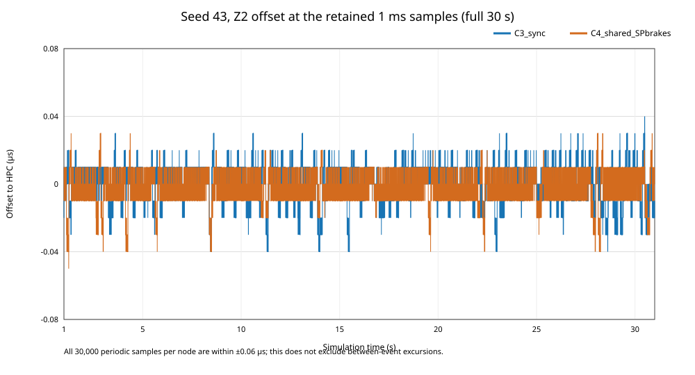

# gPTP synchronization audit — C4 shared-SP-brakes pilot

**Scope.** This audit distinguishes an offset-export defect from a real synchronization failure. It uses the pilot's retained data first, then two initial technical-only 2 s runs and two precision-corrected technical-only 2 s reruns at L2/A1, seed 43. It does not change P1, official C0–C3, the frozen `reduction_11` profile, GCLs, workload, drifts, gPTP intervals, or acceptance limits. It does not assess C4 as validated. The audit keeps the independent TC4 queue-stability failure in force.

## Finding

The millisecond-scale maxima previously reported for synchronized runs are **not evidence of millisecond clock error or a free-clock series mixed into the synchronized series**. In INET 4.7's `SettableClock`, a phase update emits the old clock value, applies the update, and emits the new value on `timeChanged`. The old extractor sorted equal-simulation-time rows by clock value, destroying this emission order; it then treated every emission as an independent offset sample and its duration interpolation could bridge the phase-update group. At seed 41, for example, the original vector order at simulation time 30.8757427528 s contains three near-zero values and one intermediate value between them in event order (up to +1.378532 ms at Z2). Adjacent regular samples remain within tens of ns. This explains the old maximum and the apparent short violation duration; it does not establish that a TAS event observed that internal intermediate value.

The corrected, complete-run 1 ms grid series for the 30 s measurement has no samples above 1 µs in any retained run. Across the 44 run/node series, sampled maxima are at most 0.06 µs and sampled p99 values at most 0.04 µs. Those periodic observations alone cannot prove a continuous-time pass. The first two direct seed-43 probes used same-instant `IClock::getClockTime()` snapshots but serialized absolute readings with six significant digits; their apparent **10 µs** differences were false positives caused by subtracting rounded values. The precision-corrected reruns at the same times find only −20 ns (C3_sync/Z1) and −20/−40 ns (C4 downstream clocks). Across retained 1 ms full-run samples and the corrected short probes, no observed offset exceeds 1 µs. This is a sampled pass only; the strict continuous-time criterion remains unverified.

## Signal path and installed-version source audit

Installed software is OMNeT++ 6.4.0 and INET `inet-4.7.0-dfe270b21f` from `/home/jonatan/omnetpp/samples/inet-4.7.0` (the installed source tree has no Git metadata). The relevant installed files and hashes are listed in [`audit.json`](audit.json).

| Signal/object | Installed behavior and audit interpretation |
|---|---|
| `ClockBase.timeChanged` | Its statistic uses `localSignal(timeChanged)`, vector recording, linear interpolation. Local-signal filtering excludes signals bubbled up from child modules. |
| `SettableClock` | The synchronized parent clock is the clock read by its clients. It owns an `underlyingClock` of type `OscillatorBasedClock`, connected to the node oscillator; this represents the free oscillator. |
| `SettableClock.setClockTime()` | Emits the old parent-clock value, changes phase/rate, then emits the new value. Same-simulation-time emission order is semantically relevant. |
| gPTP | `Gptp` holds the parent `SettableClock` as its controlled clock and the underlying oscillator clock for local timestamp operations. The step servo updates the parent clock using phase and rate corrections. |
| TAS | The pilot explicitly sets each gate `clockModule` to the node's `^.^.^.^.clock`, i.e. the parent synchronized clock; it does not point to `underlyingClock`. |
| Extractor | It selected the five parent vectors (HPC, CSW, Z1–Z3 ZSW), not their underlying clocks. However, it sorted `(simulation_time, clock_value)` pairs, so equal-time phase-correction emissions were reordered by value. |

The observer's parent-level listener also receives bubbled child events and labels their source path; its direct `getClockTime()` rows separately identify parent and free clocks. The installed INET statistic's `localSignal` does **not** mix those child events into the parent vector. The five exported clocks match the intended participants, but `hasTimeSynchronization=true` alone only establishes configuration presence; it does not prove the measured synchronization criterion or gate-clock wiring. Gate wiring was independently checked in the effective pilot command/configuration.

## Existing 30 s data: corrected interpretation

The following table compares the legacy all-emission maximum with the recomputed regular 1 ms population over `[1,31)` s. The corrected p99/max are computed from exactly 30,000 grid observations per node; no extrapolation and no interpolation across a correction jump are used. `t=1 s` is the last warm-up boundary sample. Values are microseconds.

| Variant / seed | Node | Legacy max (µs) | Legacy max time (s) | Grid p99 (µs) | Grid max (µs) | Grid max time (s) | Offset at 1 s (µs) | Grid samples >1 µs |
|---|---|---:|---:|---:|---:|---:|---:|---:|
| C3_sync / 41 | CSW | 706.502 | 30.875742 | 0.02 | 0.03 | 16.163 | 0.01 | 0 |
| C3_sync / 41 | Z1 | 409.448 | 30.875743 | 0.03 | 0.04 | 5.741 | 0.00 | 0 |
| C3_sync / 41 | Z2 | 1378.532 | 30.875743 | 0.03 | 0.04 | 18.364 | 0.01 | 0 |
| C3_sync / 41 | Z3 | 676.752 | 30.875743 | 0.03 | 0.05 | 19.366 | 0.01 | 0 |
| C3_sync / 43 | CSW | 489.297 | 30.876118 | 0.02 | 0.03 | 30.498 | −0.01 | 0 |
| C3_sync / 43 | Z1 | 876.181 | 30.876119 | 0.03 | 0.04 | 3.996 | −0.03 | 0 |
| C3_sync / 43 | Z2 | 2488.699 | 30.501116 | 0.03 | 0.04 | 22.986 | −0.02 | 0 |
| C3_sync / 43 | Z3 | 1702.151 | 30.876119 | 0.03 | 0.04 | 13.620 | −0.01 | 0 |
| C3_sync / 47 | CSW | 901.864 | 30.875515 | 0.03 | 0.04 | 6.736 | 0.00 | 0 |
| C3_sync / 47 | Z1 | 63.900 | 30.875516 | 0.04 | 0.06 | 6.997 | −0.01 | 0 |
| C3_sync / 47 | Z2 | 1929.350 | 30.875516 | 0.03 | 0.05 | 18.748 | 0.00 | 0 |
| C3_sync / 47 | Z3 | 441.590 | 30.875516 | 0.04 | 0.06 | 6.736 | 0.00 | 0 |
| C4 full-path diagnostic / 41 | CSW | 706.468 | 30.875744 | 0.02 | 0.02 | 8.360 | 0.00 | 0 |
| C4 full-path diagnostic / 41 | Z1 | 409.874 | 30.875745 | 0.02 | 0.02 | 8.643 | 0.00 | 0 |
| C4 full-path diagnostic / 41 | Z2 | 1378.346 | 30.875745 | 0.02 | 0.03 | 16.707 | 0.01 | 0 |
| C4 full-path diagnostic / 41 | Z3 | 676.796 | 30.875745 | 0.02 | 0.02 | 12.174 | 0.00 | 0 |
| C4 shared / 41 | CSW | 706.468 | 30.875744 | 0.02 | 0.02 | 8.360 | 0.00 | 0 |
| C4 shared / 41 | Z1 | 409.874 | 30.875745 | 0.02 | 0.02 | 8.643 | 0.00 | 0 |
| C4 shared / 41 | Z2 | 1378.346 | 30.875745 | 0.02 | 0.03 | 16.707 | 0.01 | 0 |
| C4 shared / 41 | Z3 | 676.796 | 30.875745 | 0.02 | 0.02 | 12.174 | 0.00 | 0 |
| C4 shared / 43 | CSW | 489.198 | 30.876118 | 0.02 | 0.03 | 25.187 | 0.00 | 0 |
| C4 shared / 43 | Z1 | 876.462 | 30.876118 | 0.03 | 0.04 | 22.248 | −0.01 | 0 |
| C4 shared / 43 | Z2 | 2519.452 | 30.876118 | 0.03 | 0.05 | 1.242 | 0.00 | 0 |
| C4 shared / 43 | Z3 | 1701.962 | 30.876118 | 0.03 | 0.05 | 14.122 | 0.00 | 0 |
| C4 shared / 47 | CSW | 901.690 | 30.875517 | 0.02 | 0.02 | 8.397 | −0.01 | 0 |
| C4 shared / 47 | Z1 | 64.146 | 30.875518 | 0.02 | 0.03 | 29.725 | −0.02 | 0 |
| C4 shared / 47 | Z2 | 1929.094 | 30.875518 | 0.02 | 0.03 | 18.240 | −0.01 | 0 |
| C4 shared / 47 | Z3 | 441.974 | 30.875518 | 0.02 | 0.03 | 17.535 | −0.01 | 0 |

The raw seed-41 event-order example is in [`data/raw_event_order_example_seed41.json`](data/raw_event_order_example_seed41.json). The regular grid plot for seed 43 is [`figures/periodic_offsets_seed43.svg`](figures/periodic_offsets_seed43.svg):

 The grid result corrects the old “millisecond drift throughout measurement” interpretation; it does **not** prove the ≤1 µs limit continuously.

## Direct technical probes, seed 43

The initial two technical probes had enough event context but insufficient timestamp serialization precision. They are retained as historical evidence only; their offsets and threshold flags are superseded. Two precision-corrected short reruns used the same seed-43 L2/A1 calendar, recorded drifts, workload and treatment settings, warm-up 1 s, observation `[1,3)` s, and 3.05 s stop. The corrected observer takes simultaneous native fixed-point parent-clock snapshots and subtracts HPC before writing raw ticks. It separately records the underlying/free clock. A periodic observer and callbacks are summarized separately, and no interpolation is used.

| Corrected run | Node | Periodic n / p99 / max | `timeChanged` n / p99 / max | Samples >1 µs (periodic / callback) |
|---|---|---|---|---:|
| C3_sync seed 43 | CSW | 2,000 / 0.01 / 0.02 µs | 2,048 / 0.01 / 0.02 µs | 0 / 0 |
| C3_sync seed 43 | Z1 | 2,000 / 0.02 / 0.03 µs | 2,048 / 0.02 / 0.03 µs | 0 / 0 |
| C3_sync seed 43 | Z2 | 2,000 / 0.02 / 0.03 µs | 2,048 / 0.02 / 0.03 µs | 0 / 0 |
| C3_sync seed 43 | Z3 | 2,000 / 0.02 / 0.02 µs | 2,048 / 0.02 / 0.02 µs | 0 / 0 |
| C4 shared seed 43 | CSW | 2,000 / 0.02 / 0.02 µs | 2,048 / 0.02 / 0.02 µs | 0 / 0 |
| C4 shared seed 43 | Z1 | 2,000 / 0.03 / 0.03 µs | 2,048 / 0.03 / 0.03 µs | 0 / 0 |
| C4 shared seed 43 | Z2 | 2,000 / 0.04 / 0.05 µs | 2,048 / 0.04 / 0.05 µs | 0 / 0 |
| C4 shared seed 43 | Z3 | 2,000 / 0.03 / 0.04 µs | 2,048 / 0.03 / 0.04 µs | 0 / 0 |

The exact old-versus-new readings at the cited peaks and the adjacent raw rows are in the [precision report](precision/precision_audit.md), [`precision_peak_snippets.csv`](precision/precision_peak_snippets.csv), and [`legacy_precision_comparison.csv`](precision/legacy_precision_comparison.csv). The corrected probes do not replace the full 30 s runs. Their 1 ms observer is not assumed timing-neutral, and observed points do not prove continuous compliance.

### Servo evidence and limitations

Each downstream node has 16 `oscillatorCompensationChanged` updates in `[1,3)` s. Across those updates, the compensation ranges were approximately CSW −15.92…−15.76 ppm, Z1 −28.48…−28.32 ppm, Z2 −81.75…−81.43 ppm, and Z3 −55.28…−55.04 ppm, consistent in sign and scale with the registered relative oscillator drifts. These records support that frequency compensation was applied. The former 10 µs phase-aligned reading at 1.247 s is an export-rounding artifact; corrected same-event offsets are −20/−40 ns. Available evidence does not attribute residual tens-of-nanoseconds differences to a specific Sync, Follow_Up, Pdelay, correction, or gate event.

The pilot log parser could not recover gPTP message counts (zero matched send events because the installed log format did not match the parser). Technical-run vectors preserve `gmRateRatio`, `neighborRateRatio`, `pdelay`, and `packetDropNotAddressedToUs`, but no validated per-message receive/process count or complete servo phase-correction log was available. Do not infer message counts from configured intervals or offered traffic. The precise probe does not establish continuous synchronization or rule out unsampled transients.

## Data handling and reproducibility

- Prior analysis and JSON were copied byte-for-byte before edits to `data/previous/`.
- The original seed-41 `.vec` order was retained in compressed form and reprocessed without sorting equal-time values. Existing compact 1 ms offsets were reprocessed for all 44 run/node series.
- The two short probes' vectors/scalars and observer traces were compressed only after validating the compressed copies; command, logs, extracted compact gPTP vectors and summaries are retained in `technical/`.
- Version/source/configuration hashes, command arguments, calendar hash, all result hashes, and per-file inventory are in [`audit.json`](audit.json). The calendar is the pilot's existing `seed43_events.csv`; the logged SHA-256 is `5163828318dfc113d004cb4e1f60773b9a0fbe225a31ed8e1182d93353b46982`.
- Three setup attempts failed before a methodological simulation started (NED package path, stale NED search path, and observer scheduled before clock initialization). They were fixed within this isolated audit harness and are retained as technical setup notes in `audit.json`; the two actual probes returned success. They do not count as pilot treatment executions.
- No original pilot result was overwritten. The previous report/JSON are preserved. No campaign result or official source/configuration was changed.

## Answers and effect on conclusions

1. **Do millisecond offsets represent the clock TAS uses?** The old recorded signal is the parent `SettableClock`, the clock the pilot explicitly assigns to TAS. But the millisecond maxima are transient setter emissions at one simulation time, not evidence of a millisecond-long offset. The probe did not establish whether a gate consumed that internal intermediate value.
2. **Was there free-clock mixing, alignment or interpolation error?** No free-clock mixing was found. The key export defect is sorting equal-time `timeChanged` records by value and counting all transition emissions as samples; interpolating across those transitions also invalidates the old duration estimate. The 1 ms periodic comparison itself aligns both parent clocks at a common simulation instant.
3. **Did gPTP correct phase and frequency?** Frequency-compensation updates are observed and have the expected scale; the installed servo code applies phase and rate corrections to the parent clock. Complete message counts and a causal trace for individual phase corrections are unavailable.
4. **Does ≤1 µs pass after audit?** All retained full-run 1 ms samples and the corrected two-second seed-43 samples are below threshold. The apparent 10 µs readings were produced by rounded absolute timestamps. This is not proof of continuous compliance over 30 s.
5. **Does it occur without TAS?** The cited C3_sync event does not show a real violation after precision correction: Z1 is −20 ns at 1.801 s. No >1 µs sample was observed in the short corrected C3_sync probe.
6. **What earlier conclusion changes?** Withdraw the claim that free oscillators accumulated milliseconds of *synchronized-clock* error or that the old interpolated short-duration percentages were valid. Replace it with “legacy same-time ordering corrupted earlier all-emission maxima, and six-significant-digit export corrupted the direct-probe offsets; corrected observed samples are below 1 µs, while continuous compliance remains unverified.” The C4 overall rejection remains because sustained CBS queue growth/overflow independently fails stability, and strict synchronization is not demonstrated.
7. **What would need re-running after a model change?** An export-only fix requires reprocessing, not rerunning. If the gPTP/clock behavior itself changes, repeat the synchronized C3 control and relevant C4 variants under the same paired calendar/drifts and full 30 s window across seeds 41, 43, and 47; the short technical probes do not replace those runs. No official C0–C3 rerun is implied unless shared model behavior is changed.

The audit therefore corrects the synchronization diagnosis but does not change the queue-stability result, endorse the C4 treatment, alter the P1, or authorize a campaign. The following precision correction supersedes this report’s initial diagnosis of direct 10 µs excursions.

## Precision correction (2026-10-12; authoritative for the 10 µs claim)

The conclusion above that the seed-43 probe directly observed real 10 µs parent-clock excursions is **withdrawn**. The legacy `ClockAuditProbe.cc` wrote absolute `double` clock values with default six-significant-digit stream formatting, and `analyze_probe.py` subtracted the exported strings afterward. At timestamps near 1.25–1.80 s, that quantization can turn true −20 ns offsets into apparent −10 µs offsets.

New isolated native-tick probes at the same timestamps measure C3_sync/Z1 = −20 ns at 1.801 s, and C4/CSW/Z1 = −20 ns, Z2/Z3 = −40 ns at 1.247 s. The old exact −10 µs values are serialization artifacts. Corrected short-window samples and the full-run 1 ms grid contain no observed offsets above 1 µs, but continuous compliance is not established. The synchronization status is therefore **sampled pass, continuous unverified**, rather than a confirmed observed failure or a strict approval.

See the detailed [precision audit](precision/precision_audit.md), [machine-readable summary](precision/precision_summary.json), corrected observer source, exact raw-tick snippets, and serialization regression test. The independent C4 CBS queue instability finding remains unchanged. Earlier wording in this report is preserved above for traceability but superseded by this correction.
